# P99 从 80 ms 涨到 600 ms，平均值几乎没变：少数请求变慢了 {#p99-tail}

P99 飙升、平均值不动，意思是最慢的 1%–2% 请求从 80 ms 恶化到 600 ms，其余请求基本正常。最常见原因是排队争用、个别实例或下游变慢、少数请求走了慢路径。排查从慢请求的 trace 开始，不是从全局指标开始。

- 平均值对尾部不敏感：15/1000 个请求涨到 600 ms，平均值只涨约 8 ms。
- 尾部恶化几乎总是某一部分请求出问题，不是接口整体变慢。
- 顺序原则：先定位慢在哪一段，再按维度切分，最后对照变更和资源。

@answer scope="数值为示意 · 假设常见 Web/微服务接口 · P99 按第 990/1000 个值计"
@meta locale=zh-CN

## 为什么平均值没动？ {#why-mean-flat}

```mermaid title="接口延迟前后对比"
xychart-beta
  x-axis ["平均值", "P50", "P99"]
  y-axis "ms" 0 --> 700
  bar "之前" [80, 80, 80]
  bar "之后" [88, 80, 600]
```

985 个请求 80 ms 加 15 个请求 600 ms：平均值 `(985×80 + 15×600) / 1000 = 87.8` ms，只多 7.8 ms；P99 取第 990 个值，正好落在 15 个慢请求里，于是跳到 600 ms。平均值掩盖尾部问题，这正是要监控 P95/P99 的原因。

## 按什么顺序排查 {#triage-order}

@workflow id=p99-triage title="排查顺序：先定位，再切分"
| lane locate | 先定位 |
| lane split | 再切分 |
| lane fix | 后对照 |
| confirm | 确认指标口径 | external | locate |
| trace | 抽样慢请求 trace | backend | locate |
| dim | 按实例/下游/参数切分 | backend | split |
| change | 对照发布与配置变更 | backend | fix |
| res | 检查资源争用 | backend | fix |
| confirm > trace | 现象属实 |
| trace > dim | 慢在哪段 |
| dim > change | 集中到某维度 |
| change > res | 无变更则查资源 |

@steps id=triage-steps
| s1 | 确认指标口径 | 看 P50/P95 是否也涨，排除聚合或采样方式变化。 | p99-triage | confirm |
| s2 | 抽样慢请求 trace | 抓至少 10 条 ≥500 ms 的 trace，看时间花在排队、下游还是自身处理。 | p99-triage | trace |
| s3 | 按实例/下游/参数切分 | 慢请求集中在某个实例、某个下游，还是共享某个参数。 | p99-triage | dim |
| s4 | 对照发布与配置变更 | 尖刺起点对齐 deploy、配置、feature flag、依赖升级。 | p99-triage | change |
| s5 | 检查资源争用 | 看连接池等待、线程池队列、GC 暂停、CPU 限流、锁竞争。 | p99-triage | res |

## 最可能的原因 {#causes}

| 候选原因 | 典型迹象 | 怎么确认 |
| --- | --- | --- |
| 排队与资源争用 | trace 里等待占大头，延迟随负载波动 | 看连接池、线程池等待时间与队列深度 {caution:最常见} |
| 单个坏实例 | 慢请求集中在一两个节点 | 按实例切 P99，找离群节点 |
| 下游尾部变慢 | 慢 trace 中下游 span 占八成以上 | 查慢查询、锁等待、缓存命中率 |
| 慢路径或异常参数 | 慢请求共享某参数、某用户或大请求体 | 对慢样本做特征聚类 |
| GC 或运行时暂停 | 周期性尖刺，与 GC 日志时间重合 | 对比 STW 时长与尖刺时刻 |
| 重试放大 | 下游偶发超时引发重试 | 看下游 QPS 是否同比放大 |

## 动手清单 {#checklist}

- [ ] 拉最近 1 小时 ≥500 ms 的 trace，至少 10 条
- [ ] 按实例、下游、接口参数切分慢请求分布
- [ ] 尖刺起点对照部署、配置、flag 变更时间线
- [ ] 检查连接池/线程池等待、GC 暂停、CPU 限流指标
- [ ] 确认 P50/P95 走势，区分尾部恶化与口径变化
